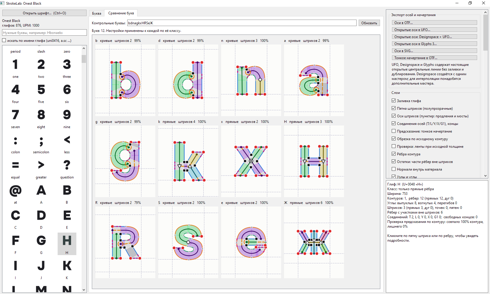

# StrokeLab

**English** | [Русский](README.ru.md)

**Vector stroke-axis analysis and thin-outline prediction for type design.**

StrokeLab is an experimental font-design utility that analyzes glyph outlines as vector geometry, estimates the central axes of their strokes, and uses those axes to predict a thinner version of the glyph.

- **Author:** Andrey Kudryavtsev
- **GitHub:** <https://github.com/fonterior/>
- **Repository:** <https://github.com/fonterior/strokelab>
- **Platform:** Windows 10 (the current release is primarily documented and tested for Windows)
- **License:** PolyForm Noncommercial License 1.0.0

> StrokeLab is source-available under a noncommercial license. It is not an OSI-approved Open Source project because commercial use is restricted.

## Screenshot



## What it does

StrokeLab works with the vector outlines stored in font files. It does not rasterize glyphs and does not use a Voronoi diagram as the basis of its analysis.

The application is intended to help a type designer inspect stroke structure, identify likely centerlines, and generate a starting point for a lighter master. The result is an algorithmic prediction, not a guarantee of a production-ready font outline. Inspect and correct generated contours before using them in a released typeface.

### 1. Contour analysis

Glyph contours are decomposed into straight segments and curved segments. The analysis calculates geometric properties such as tangents, curvature/turning, segment length, and inward-facing normals. Nodes are classified by their local geometry, including convex corners, concave corners, smooth nodes, and inflection points.

### 2. Stroke candidates and center axes

A stroke is modeled as a region bounded by two sides. Candidate opposing edges are tested using inward normal rays, the direction of their normals, and an empty-circle test based on the segment joining two sample points. The current matching logic pairs straight edges with straight edges and curved edges with curved edges.

The midpoints between accepted pairs form center-axis samples. Their separation provides a local estimate of stroke thickness. Fragmented axis pieces can be joined, and transitions between adjoining pieces are smoothed.

### 3. Shared axes and junction prediction

The application distinguishes a genuine stroke terminal from a junction. Junctions are evaluated using support in the original contour, including nearby concave corners. The current model accounts for several common connection types:

- **T** — one stroke terminates at another stroke's axis;
- **L** — two strokes meet at an angle;
- **Y** — three stroke ends meet in a common junction;
- **X** — two axes cross;
- **G1** — a smooth continuation, for example between a stem and an arch or along an S-shaped curve.

Extensions are constrained by the glyph's material. Where a proposed centerline would leave the material, the path can follow the middle of the available passage instead. Free ends are extended toward the visible terminal rather than being connected to an unrelated stroke.

### 4. Thin-outline prediction

Stroke ribbons are reconstructed from the axes and measured thickness profile. At the original thickness, the reconstructed ribbons can be compared with the source outline; the application reports overlap/match and excess-area information. Reducing the thickness produces a predicted lighter outline.

Different parameter sets are available for glyphs with straight-only contours and glyphs containing curves. The application selects a parameter set according to the detected glyph class.

### 5. Terminals, dots, and export

- Terminals are clipped against the original terminal boundary, preserving angled or slanted cuts and avoiding protruding corners.
- Dots and detached marks, such as the dot of **i**, **j**, and a colon, are handled separately and can be reduced around their centers.
- T-junctions use a straight connection by default; a rounded entry is used only when the terminal is nearly parallel to the receiving stem.
- Original centerline paths can be exported as open, unfilled paths to UFO, Designspace, and Glyphs-compatible workflows. Some Glyphs 3 export functions require the optional export packages listed below.

## Installation

### Requirements

- Windows 10 or later (other platforms may work, but are not the primary target of this release).
- Python **3.11 or newer** for the current, unpinned dependency set. Recent FontTools releases require Python 3.11 or newer.
- An OpenType or TrueType font file that can be read by FontTools.

### 1. Create a virtual environment

Open PowerShell in the directory containing `Strokelab.py`:

```powershell
py -3 -m venv .venv
.\.venv\Scripts\Activate.ps1
python -m pip install --upgrade pip
```

If PowerShell blocks activation, you can call the environment's Python directly using `.venv\Scripts\python.exe` instead.

### 2. Install the required packages

```powershell
python -m pip install -r requirements.txt
```

### 3. Install optional features (optional)

```powershell
python -m pip install -r requirements-optional.txt
```

The optional packages enable path-overlap removal and additional font-source export workflows. StrokeLab should still start without them; the corresponding features may be unavailable.

## Run

Launch the application without an input font:

```powershell
python Strokelab.py
```

Or pass a font file when starting the application:

```powershell
python Strokelab.py "C:\Fonts\Example-Bold.otf"
```

A font file can also be dragged into the application window.

## Canvas controls

| Action | Control |
|---|---|
| Zoom around the cursor | Mouse wheel |
| Pan the canvas | Drag with the left, middle, or right mouse button |
| Inspect a stroke or edge | Click a stroke region or near an edge line |
| Fit the glyph to the view | Double-click |

The exact controls and labels may change as the application develops.

## Repository contents

The repository is expected to contain at least:

```text
strokelab/
├── Strokelab.py
├── README.md
├── README.ru.md
├── LICENSE
├── THIRD-PARTY-NOTICES.md
├── requirements.txt
├── requirements-optional.txt
├── CITATION.cff
└── .gitignore
```

## Licensing and permitted use

The StrokeLab source code is made available under the **PolyForm Noncommercial License 1.0.0**. Read the complete terms in [`LICENSE`](LICENSE) before using, modifying, or redistributing the program.

In general, the license permits use, modification, and redistribution for permitted noncommercial purposes. It expressly describes certain personal activities—such as personal study, research, experiments, hobby projects, and private entertainment—provided there is no anticipated commercial application. It also identifies certain noncommercial organizations and their uses as permitted.

**Commercial use is not granted by this license.** Anyone wishing to use StrokeLab commercially must obtain separate, express permission from the author before doing so. The meaning of “commercial” can depend on the facts and context; contact the author before relying on an assumption that a particular use is noncommercial.

When redistributing StrokeLab or any part of it, you must provide recipients with a copy of the PolyForm Noncommercial License or its official URL, and preserve the project's `Required Notice:` lines. See [`LICENSE`](LICENSE). The source file should also carry the SPDX identifier `PolyForm-Noncommercial-1.0.0` and the two required notices shown at the end of `LICENSE`.

This is a source-available project, not an OSI-approved Open Source project. The noncommercial restriction is intentional.

### Generated fonts and user files

The StrokeLab license applies to the StrokeLab program itself. It does not, by itself, place a license on font files that users open, process, or create with the program. The rights and licensing of those font files remain subject to their own copyright, license terms, and applicable law. Users are responsible for ensuring that they have the necessary rights to the fonts they process and distribute.

## Third-party software

StrokeLab relies on third-party packages that are distributed under their own licenses. Those licenses are separate from the StrokeLab license and are not replaced by it. See [`THIRD-PARTY-NOTICES.md`](THIRD-PARTY-NOTICES.md) for the direct dependencies and their license information.

In particular, PySide6/Qt for Python is available under LGPL/GPL options and a commercial license. The exact Qt modules included in a build matter. Qt states that recipients' LGPL freedoms must not be restricted. Because StrokeLab itself is offered only for noncommercial purposes, do not assume that the app-level PolyForm restriction and every possible PySide6/Qt distribution arrangement are automatically compatible. Review the specific integration and distribution model before publishing a bundled executable. If you redistribute a packaged executable that contains Qt/PySide6, LGPL obligations may include providing the corresponding Qt source code, license notices, and a practical way for recipients to replace/relink the Qt libraries and run the resulting application. Do not assume that the repository's license notice alone is sufficient for an executable bundle.

## Disclaimer

StrokeLab is provided “as is”, without warranty. The application is experimental and may produce incomplete, irregular, or unsuitable outlines. Always inspect generated paths and verify the resulting font in your font editor and in representative text before using or distributing it.

## Author

**Andrey Kudryavtsev**  
GitHub: <https://github.com/fonterior/>

For commercial licensing inquiries, use the contact options available on the author's GitHub profile.
